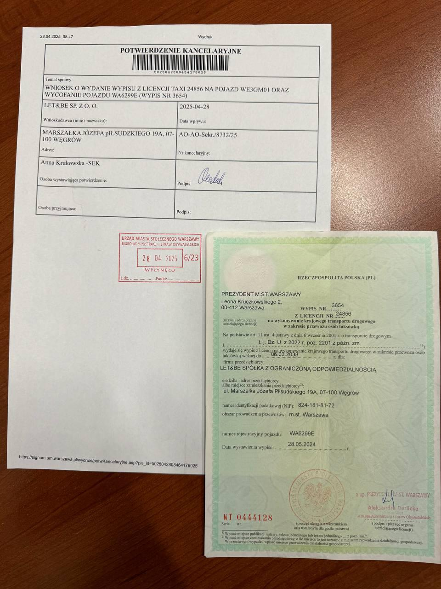

# Замена выписа

**Замена выписов будет производиться только на фирму LITLEO. На LET\&BE замена выписов НЕ проводится!**&#x20;

При желании получения замены, нужно будет делать подачу на идентификатор и выпис на обе фирмы, так как оригиналы будут только на LET\&BE, а на LITLEO временные пока не водитель получит готовый выпис на LET\&BE.&#x20;

Оригинал выписа, идентификатора и разрешения на работу оформляется только через LET\&BE.

Все приложения (Uber, Bolt, FreeNow) принимают документы с заменой выписа — человек сможет спокойно работать. На руки водитель будет получат замену, по примеру:\

_**Выписы для замены у нас есть в наличии, выдаются бесплатно.**_

При остановке полиции за работу по замене выписа:

Водителю может быть наложен штраф до 500 злотых, а фирма может получить штраф в размере до 2000 злотых. (Мы, готовы нести ответственность за возможные штрафы)

Мы продолжаем информировать, что работа по замене выписов считается нелегальной.

Тем не менее, если водитель осознанно принимает решение — он может продолжать работу по замене. Как только водитель получает оригинальный выпис на фирму LET\&BE, его аккаунт переводится с флоты LITLEO на LET\&BE для дальнейшей легальной работы (у него есь ровно неделя для переключения, иначе мы отключим аккаунты). \
\
Замена которая будет выдаваться на руки водителю, подходит для: **Uber и Freenow**, документ для **Bolt** будет находится в папке - Замены (у регистраций есть доступ).\
\
**В Uber авто будет добавляться на флоту при наличии замены выписа.**\
\
&#x20;
