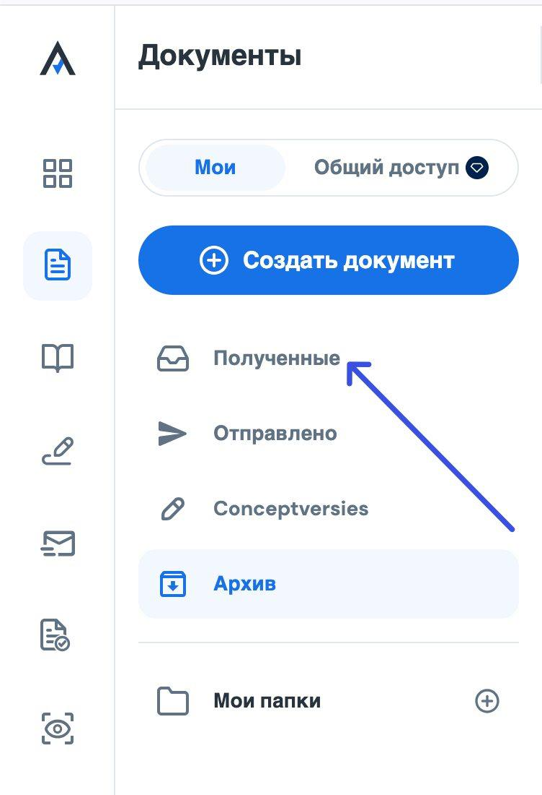
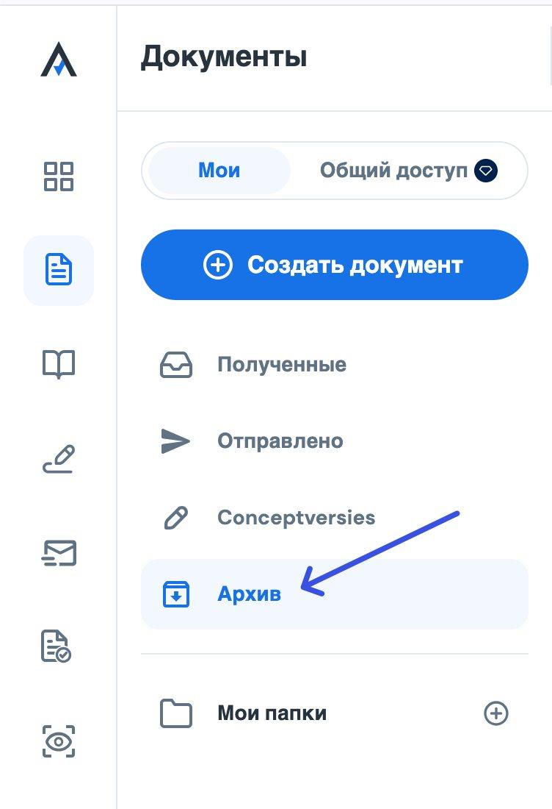
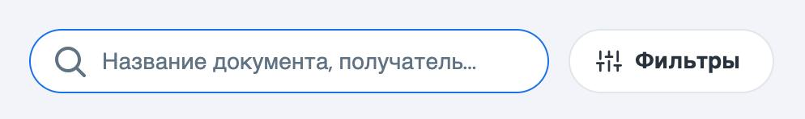

# Дополнительный сервисы

## [**Autenti**](https://account.autenti.com/login)

> платформа для отправки договоров, проверки статуса подписи.

* **Let\&Be** - основной договор делается именно на Let\&Be, его должен иметь каждый водитель или курьер подключенный к нам.&#x20;
* **Litleo -** договор для выплат каждый день и приложений Glovo Wolt и Stuart.&#x20;

<figure><figcaption></figcaption></figure>

В полученных/отправленных мы проверяем договора если они были отправлены пару дней назад или день в день.

 

<figure><figcaption></figcaption></figure>

В архиве проверяем договора которые были отправлены давно, просто на наличие того или иного договора.

<figure><figcaption></figcaption></figure>

Проверка происходит по почте на которую был отправлен договор. 

<figure><figcaption></figcaption></figure>

Статус подписано с двух сторон - значит можно начинать подключение аккаунтов. Скриншот о статусе подписи мы отправляем человеку, по примеру ниже:\
.png>)

### [**Анкета/Jotform**](https://promin.jotform.com/share/azg4OHJsUnlGcnpDTWY4STR6WmFkcFhDajEyZXJlS2liZElRTzdxbVhRWDRWdVFZZ29TSGl1OU9zYm9Kd0xORWFpQ0E5UjF3aUNqTjU0U1dPcCtzUzdJRjUyQW5NVlF4cDd2TnVWelJjSDVEZjVWeTJZbjBVWmJSU3p5eFVGbE8=)

> электронная система, через которую мы можем увидеть все необходимые данные о водителе, где указан номер счета, вставлены ключи аккаунтов. Благодаря анкете генерируется много важных факторов, если не будет указан ключ одного из приложений по которому человек работает с нами - не будет отправлена выплата, если не будет указан номер счета - исход будет такой же. Также там указывается подписан ли с человеком трудовой договор и на какую ставку, если информацию не занести, то система отправки выплаты и подсчета заработка не считает сумму ZUS и человек не будет внесен в ZUS. И конечно же основные документы человека загружены в систему анкеты/jotform.

<figure><figcaption></figcaption></figure>

<figure><figcaption></figcaption></figure>

* Submitter - сотрудник отдела финансов, которые создал анкету;
* Дата заявки - дата создания анкеты;
* Генератор случайных чисел и ID - набор букв и цифр который прикреплен к анкете водителя, чтобы его можно было найти на всех платформах и таблицах с которыми мы работаем&#x20;
* Умова Zlecenia - актуальный статус наличия трудового договора;
* Дата подписания документа - день создания анкеты;
* Email - актуальная электронная почты водителя;
* Номер телефона - актуальный номер по которому можно связаться с водителем;&#x20;
* Селфи ( фото для анкеты, профиля, аккаунтов);
* Имя и Фамилия водителя;&#x20;
* Дата Рождения водителя;
* Адрес - актуальный адрес проживания водителя;&#x20;
* Номер банковского счета - польский номер счета состоящий из 26 цифр, предварительно проверенный через [сайт](https://direct.money.pl/jaki-to-bank);&#x20;
* Pesel - польский идентификационный код человека;&#x20;
* Гражданство водителя/курьера;&#x20;
* Документ идентификации - документ удостоверяющий личность человека, может быть лишь тот документ, который подтверждает легальность в Польше;
* Номер паспорта ( номер документа предоставленного для удостоверения личности);
* Паспорт важен до ( срок действия документа предоставленного для удостоверения личности);
* Фото документа;
* Город работы водителя;
* Платформа работы - такси или доставка;
* Название приложений по которым человек будет работать;
* Тип выплаты, которую выбрал водитель.

### FAQ

**1. Какие документы удостоверяющий личность мы можем использовать для создания анкеты/договора аренды?**

1. Польское ВНЖ
2. Заграничный паспорт
3. Dowód osobisty
4. Документ подтверждающий статус международной защиты/ статус беженца&#x20;
5. Внутренний документ страны ЕС + Польский Pesel

2\. **Может ли быть не польский номер счета?** - нет. Может ли быть Revolut? - да, но польский счет.

3\. **Можно ли создать договор без номера Pesel?-** да, но если составление идет на карту побыта, то Pesel обязателен.\
\
**Promin Login -** флоты всех приложений с которыми мы работаем

<figure><figcaption></figcaption></figure>

**Флота** - система партнера, в которой отображаются актуальные данные водителя, статус аккаунта, статус авто, информация о заработках, активная карта водителей/курьеров.\
В основном флотами пользуется отдел регистрации, мы можем посмотреть информацию по надобности. 

\
 
