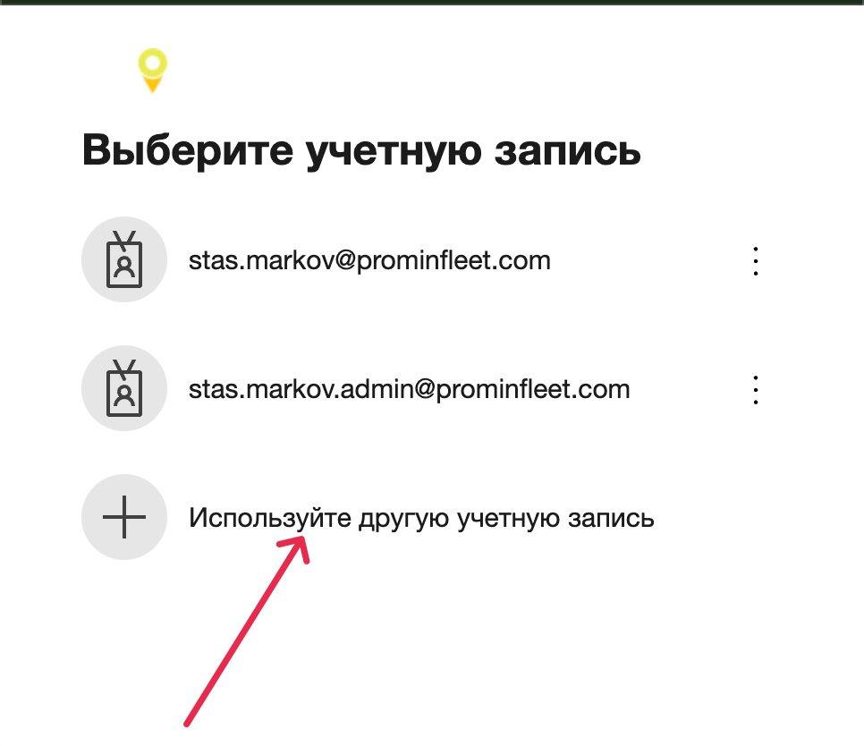
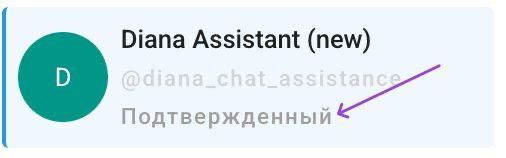
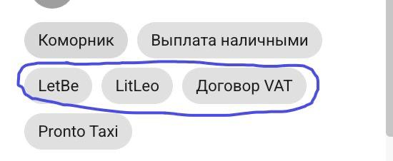

# Работа в боте

### Логин в бот

1. Перед началом необходимо получить у своего руководителя логин и пароль к учетной записи
2. Переходим на страницу входа в бот и нажимаем "Войти"

<figure><figcaption></figcaption></figure>

3. В открытом модальном окне необходимо выбрать "Использовать другую учетную запись

<figure><figcaption></figcaption></figure>

4. Вводим логин и пароль полученный на шаге 1
5. После ввода логина и пароля, необходимо подтвердить вход, это делает отдел финансов, им нужно передать код который вы видите на экране

<figure><figcaption></figcaption></figure>

6. Успешный вход в бот
7. При обработке чата наш отдел следит за тем, чтобы были отмечены категории:

*   Подтвержденный (если данные человека верифицированы и подписан договор Let\&Be)

    <figure><figcaption></figcaption></figure>
* Let\&be (если подписан договор)
* Litleo (если подписан договор)
* Договор VAT - Zasady rozliczenia faktur (если подписан договор)

<figure><figcaption></figcaption></figure>
