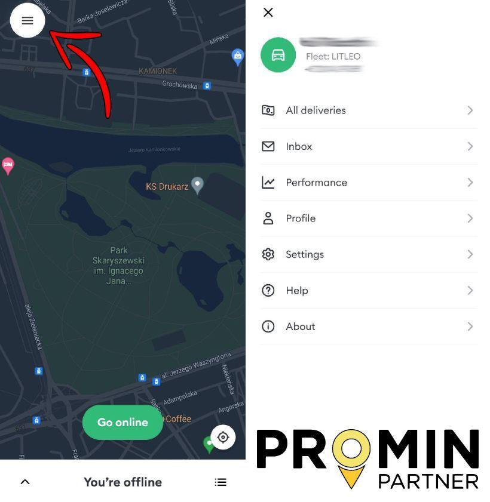

# Поддержка/Вопросы по приложениям

**Что делать если клиент не открывает дверь и не отвечает на звонок, по приложению Bolt курьер?**

> Нужно нажать на треугольник и связаться с поддержкой, объяснив ситуацию. Далее потребуется ожидать ответа от поддержки, они будут связываться с клиентом и также ожидать ответа от него, если клиент не отвечает, поддержка Bolt автоматически закрывает заказ.

**Как проверить актуального партнера через аккаунт?**

<figure><figcaption></figcaption></figure>

**23% VAT в Bolt Courier?**

> Общий заработок курьера делится на:
>
> * [x] оплата клиента (23% VAT BOLTFOOD доплачивает ТОЛЬКО к оплате клиента)
> * [x] оплата ресторана
>
> ✔ **ОПЛАТА КЛИЕНТА** — это сумма , которую КЛИЕНТ заплатил за доставку&#x20;
>
> Следовательно, нам нужно от дохода BRUTTO отнять сумму, которая получилась с возврата BOLT за оплату клиентом
>
> Так как в приложении BOLT COURIER нет разделения этих оплат, а показана ТОЛЬКО общая сумма заработка курьера ➡ высчитать сумму процента VAT, который курьеру компенсировал BOLT FOOD и который мы заберём на оплату налога НЕВОЗМОЖНО
>
> Для того, чтобы увидеть VAT нужно написать им в поддержку и попросить фактуру за требуемую неделю.

