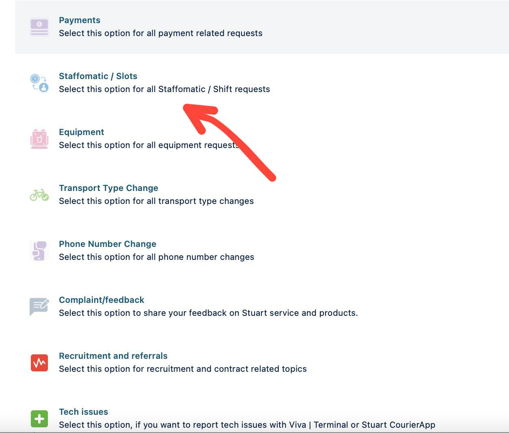
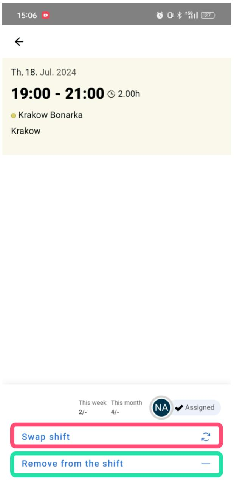

# Поддержка/Вопросы по приложениям

<figure><figcaption></figcaption></figure>

Для **активации** аккаунта **staffomatic** нужно написать в техподдержку с портала курьера - после чего вам прийдет новое приглашение для активации - https://stuart-team.atlassian.net/servicedesk/customer/portal/59\
\
https://help.stuart.com/pl/collections/3843712-pierwsze-kroki - тут можно ознакомиться со всеми **деталями для работы в Stuart.**

<figure><figcaption></figcaption></figure>

**Существуют два типа выхода из слота**

1\. "**Удалить из смены**" - возможно более чем за 24 часа до начала слота. Он вызывает полное удаление из смены без каких-либо последствий. (Нажмите на слот, из которого хотите удалить себя - затем "Remove from the shift") Кликните на слот, из которого хотите удалить себя, затем "Удалить из смены".

2\. "**Сменить смену**" - если до начала твоего слота осталось менее 24 часов, ты можешь только обменяться слотом. Внимание! Если никто не обменяется с тобой, ты все равно обязан быть на этом слоте. (Нажмите на слот, который хотите отдать - затем "Swap shift")
