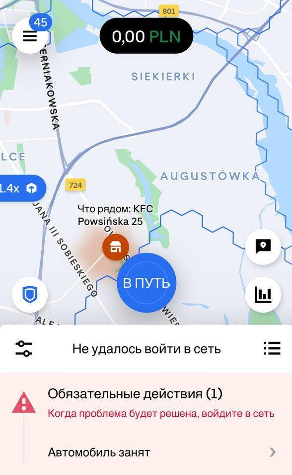

# Ошибки приложения


**Самая распространенная ошибка в Uber доставке -&#x20;**_**Автомобиль занят**_**, такая ошибка в основном у курьеров, которые работают на велосипеде.**&#x20;


<figure><figcaption></figcaption></figure>

&#x20;**в Uber доставке у курьеров два велосипеда к выбору:**

> **1 - Общий, который добавлен в автопарк партнера и его может выбрать любой подключенный курьер;**
>
> **2 - Велосипед только в аккаунте курьера.**

Поэтому при ошибке - _**автомобиль занят,**_ можно выбрать второй велосипед и продолжить работу.\
Если вдруг второго велосипеда в аккаунте не будет, а при перезагрузке приложения, ошибка все равно остается - требуется связаться с поддержкой Uber с просьбой о добавлении второго велосипеда.&#x20;


**Вторая частая ошибка -&#x20;**_**Мы сообщим вам когда вы сможете принимать заказы**_


1. Причиной может быть не пройденная верификация Ubble. Чтобы быть уверенным, что проблема именно в этом, нужно попросить выслать скриншот из вкладки "Входящие"/"Inbox", в которой должно быть уведомление со ссылкой для прохождения верификации. Для успешного прохождения верификации потребуется выполнить её с документом удостоверяющим личность, которые загружен в аккаунте. Если человек не помните, что загружал - карту побыта или паспорт, то можно проверить на флоте по дате окончания документа.
2. Причиной может быть ошибка самого приложения Uber. В таком случае нужно пробовать выйти из аккаунта и войти снова, если ошибка осталась - помогаем курьеру написать в поддержку о проблеме.
3. Массовая ошибка - сообщаем Стасу или Диане для решения ситуации через наших менеджеров Uber.  &#x20;

