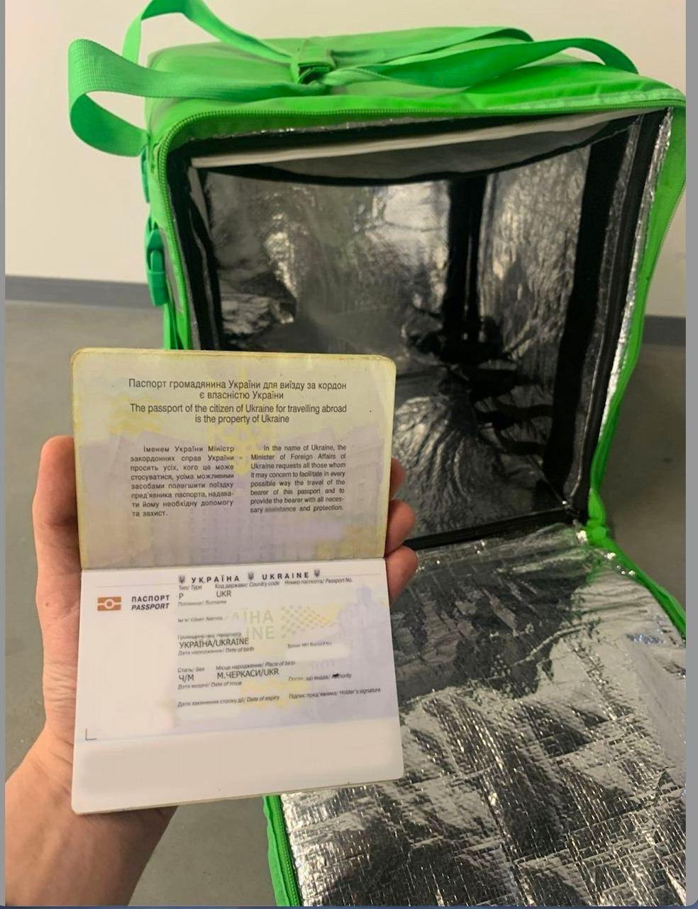

# Регистрация аккаунта

* [x] Установить приложение Uber Driver
* [x] Ввести номер телефона и электронную почту
* [x] Ввести пригласительный код (он меняется - куратор уведомляет об этом) + курьер может ввести код друга. Ввод кода необязателен и пункт можно просто пропустить.
* [x] Выбрать вариант партнерства с Uber - Доставка с UberEats на (тип транспорта)\
  .png>)
* [x] Загрузить необходимые документы:

- Удостоверение личности (загранпаспорт/карта побыта)
-   Фото термосумки с паспортом, по примеру: 

    <figure><figcaption></figcaption></figure>
- Фото водительских прав (в случае работы на авто или скутере)
- Селфи для профиля

* [x] Заполнение важных пунктов и запись на верификацию

- Sample Fleet Partner List - выбрать пункт "Close this step"
- С чего начать (условия работы с приложением)

**После заполненных пунктов водителя выпустит на карту города, подключение уже возможно, но активация только в течении 48 часов после верификации Ubble.**
