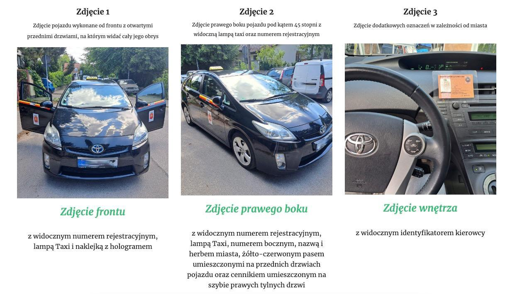

# Добавление авто

**Документы**:

* Регистрационный документ (техпаспорт) передняя сторона
* Регистрационный документ (техпаспорт) задняя сторона
* Актуальная страховка (файл PDF или фото распечатанного документа)\
  _<mark style="color:purple;">Важно: страховка должна быть актуальной и должна оставаться актуальной в течении следующих 10 дней</mark>_
* Выпис из лицензии партнера

Дополнительно потребуется 3 фото оклеенного автомобиля с установленной шашкой TAXI. 

<figure><figcaption>
 
</figcaption></figure>

В Bolt автомобиль добавляется на флоту, для этого необходимо проверить наличие всех необходимых документов и фото в чате, после этого добавить чат в папку "Регистрации" и оставить комментарий - "Добавить авто в Bolt (указать город)  "

<figure><figcaption></figcaption></figure>

<figure><figcaption></figcaption></figure>

_**После добавления авто в Bolt оно будет проходить процесс верификации. Данный процесс может занимать до 3х рабочих дней, согласно регламенту, но обычно добавление происходит быстрее**_

