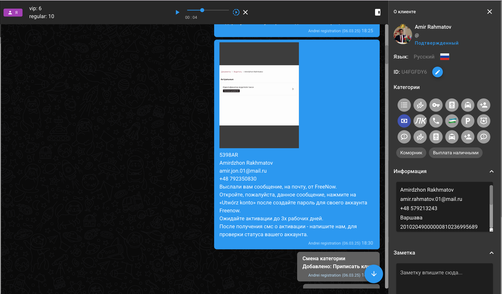

# Регистрация аккаунта

## Регистрация аккаунта FreeNow производится отделом регистрации, при условии, что все условия по нашей стороне выполнены&#x20;

_**Какие условия должны быть выполнены для того, чтобы мы произвели регистрацию аккаунта FreeNow?**_&#x20;

1. Подача на идентификатор/сглошение от нас
2. Подача на разрешение на работу/подписанный трудовой договор&#x20;
3. Подписанный договор аренды транспортного средства  (Umowa Wynajmu)
4. Оклеенное авто для работы с выписом от нас
5. Наличие подтверждения о подаче на идентификтор/идентификатор

**Если все условия выполнены, то можно добавить чат в папку "Регистрации", оставив комментарий "Регистрация FreeNow (город работы) "**

_После успешной регистрации аккаунта, водитель получит сообщение от отдела Регистрации по примеру ниже_

<figure><figcaption></figcaption></figure>

После этого, водитель получит сообщение на электронную почту, где у него будет возможность установить пароль для своего аккаунта FreeNow, далее, будет необходимо посетить офис FreeNow для верификации личности&#x20;
