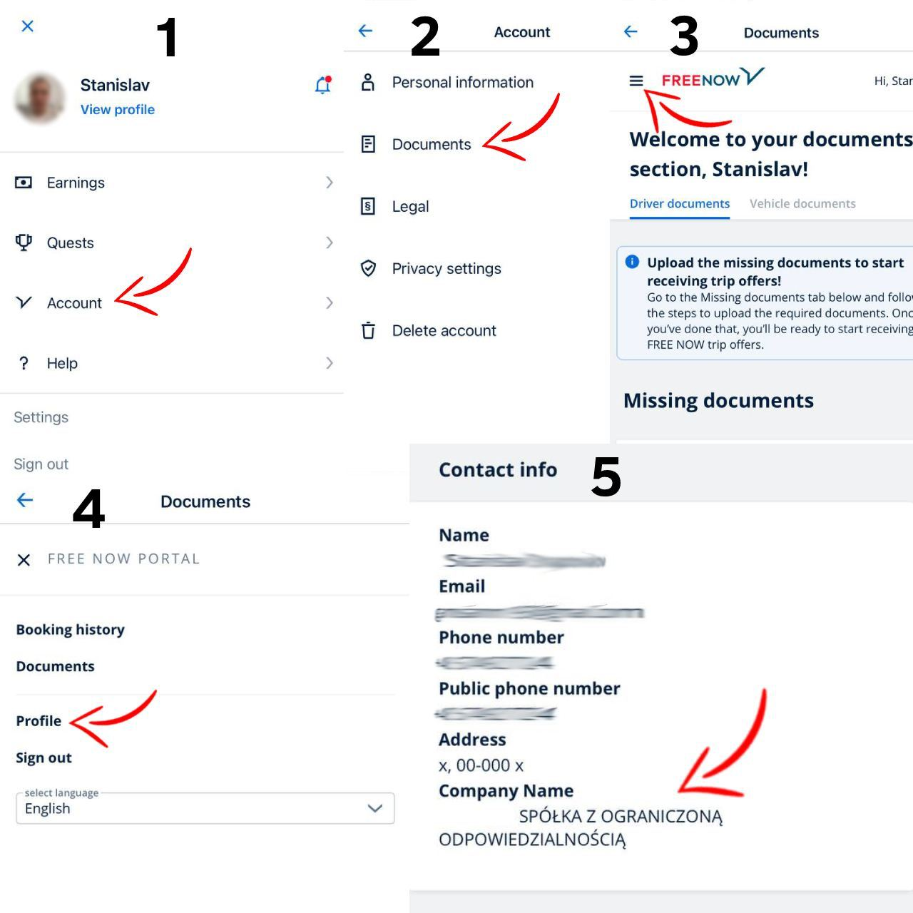

# Смена партнера

**Смена партера в FreeNow производиться путем отправления приглашения, которое приходит на электронную почту, которая привязана к аккаунту водителя**

Данный процес производиться отделом Регистрации, но перед этим нам необходимо получить скриншот по примеру ниже от водителя

<figure><figcaption></figcaption></figure>

После того, как мы получили данный скриншот от водителя, нам необходимо добавить чат в папку "Регистрации" и написать комментарий "Отправить приглашение FreeNow (город работы) "
