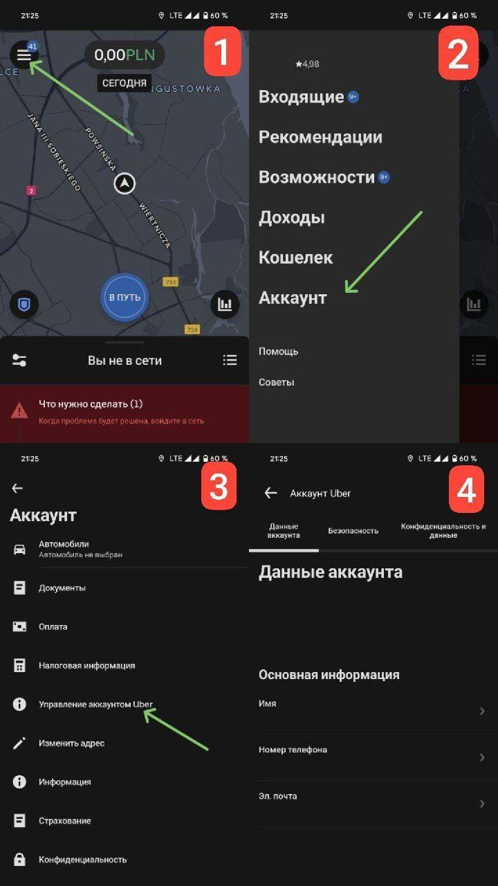
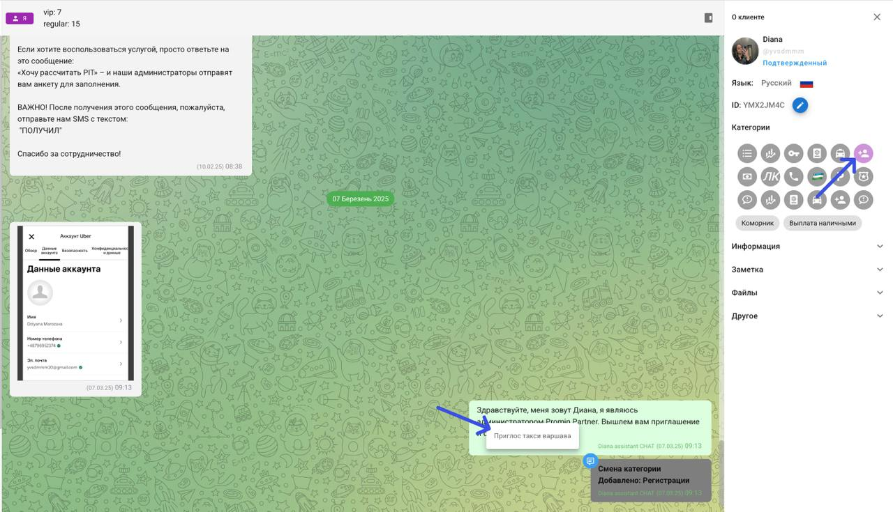

# Смена партнера

Смена партнера происходит путем принятия приглашения от нового партнера. У нас этим занимается отдел регистрации. Для начала нужно выполнить все условия подключения к нам:

* Подача/сглошение на идентификатор водителя
* Подписанный трудовой договор (Umowa Zlecenia) /подача на разрешение на работу
* Подписанный договор аренды (Umowa Wynajmu)
* Наличие оклеенного авто с готовым выписом из лицензии от нас

Для подключения нам потребуется скриншот с данными из аккаунта водителя:

<figure><figcaption></figcaption></figure>

После того, как человек вышлет нам скриншот с данными, отправляем черновик в регистрации:

<figure><figcaption></figcaption></figure>

В комментарии важно указать: такси/доставка, город работы
