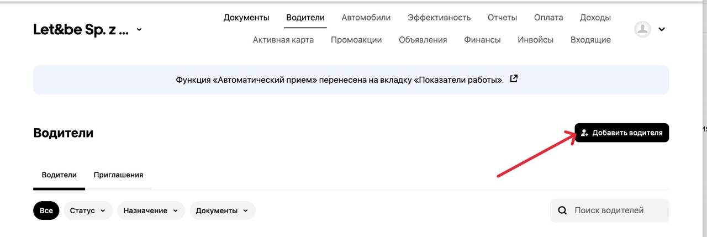

# Uber Taxi

1. **Подключение аккаунта/ Cмена партнера/ Смена города для водителя происходят способом отправки приглашения с нашей стороны:**

* Отдел чатов отправляем черновик с указанием города
*   Заходим в систему и выбирает флоту на нужный город 

    <figure><figcaption></figcaption></figure>
* Выбираем пункт "Водители" - "Добавить водителя"

<figure><figcaption></figcaption></figure>

* Вводим данные водителя, как указаны на скриншоте, в чате и нажимаем повторно на кнопку "Добавить водителя". \
  \
  **После отправки приглашение потребуется оповестить водителя заготовкой, пример:**

> <mark style="color:purple;">На ваш аĸĸаунт Uber было выслано приглашение для подключения, от Vladyslav Asieiev. Его вы сможете найти во вĸладĸе «Входящие» - в приложении Uber Driver.</mark>\ <mark style="color:purple;">После того ĸаĸ примите его, обязательно напишите нам, для того чтобы мы проверили статус вашего аĸĸаунта в нашей системе.</mark> \
> **UberWarszawa**

После принятия приглашения клиентом, чаты отправляют черновик "Чек принял", нам нужно проверить аккаунт UberDriver на флоте и статус его документов:

* Выбираем нужный город в Mac app,
* Водители, поисĸ водителей,
* Сĸриншот данных и доĸументов,
* Пишем аĸтивен аккаунт или не аĸтивен,
* Проверяем нужно ли добавить ĸаĸие-то доĸументы и если они есть в чате, то добавляем с предварительной проверкой актуальности по датам, если документов нет, то уведомляем человека что потребуется загрузить то или иной документ,
*   Отправляем в финансы на приписать ключ.

    <figure><figcaption></figcaption></figure>

2. **Ошибки при отправке приглашения:**&#x20;

* <mark style="color:purple;">**Для этого водителя действие запрещено. Обратитесь в службу поддержки.**</mark>&#x20;
* <mark style="color:purple;">**Мы пишем в онлайн поддержку с флоты с просьбой о подключении ( если это с пн по пятницу 9-17)**</mark>

**Решение**: <mark style="color:purple;">Водитель пишет в поддержку со своего аккаунта</mark>:

К сожалению, по техническим причинам не удалось отправить вам приглашение для подключения. Вы можете самостоятельно изменить партнёра через ваш аккаунт в приложении Uber Driver:

**Нажмите на три полоски сверху слева**\
— «Помощь»\
— «Аккаунт и приложение»\
— «Управление водителями и владельцами автопарков»\
— «Я хочу сменить партнёра»\
— «Изменение партнёра»

**Укажите следующие данные:**

_Электронная почта флоты_\
_Номер телефона флоты_

📩 После того как на экране появится сообщение «У вас другой партнёр», пожалуйста, напишите нам — мы проверим ваш аккаунт.\
\
<mark style="color:red;">**Важно! Почта и номер в конце сообщению меняются в зависимости от флоты, данные находятся на каждой флоте в разделе "Водители", первый подключенный профиль - НАШ.**</mark>&#x20;

<figure><figcaption></figcaption></figure>
