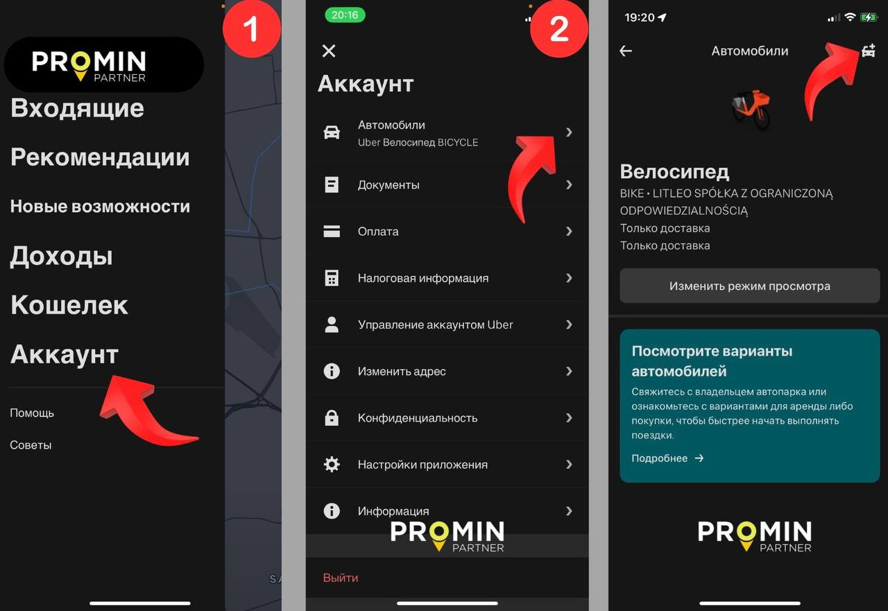

# Добавление автомобиля

1. **Требования к авто для работы в такси:**&#x20;

* Варшава: 2005 г или новее,
* Другие города: 2005 г или новее,
* Польская регистрация, страховка, техпаспорт с печатью такси, выпис из лицензии, оклейка согласно стандартам города, шашка.

**Чтобы добавить автомобиль в Uber самостоятельно, выполните следующие шаги:**

1. Откройте приложение Uber Driver → Главный экран → Три полоски → Аккаунт → Значок автомобиля.
2. Укажите марку, модель, год и номер авто.
3. Загрузите техпаспорт с печатью такси и страховку.
4. Перейдите в «Документы» и загрузите выпис из лицензии (Wypis z licencji taxi).
5. После одобрения добавьте фото оклеенного авто с номером и лампой такси в «Zdjecie samochodu z widocznym numerem rejestracyjnym oznaczeniem miejskim oraz lampą TAXI».

<figure><figcaption></figcaption></figure>

<mark style="color:red;">**По регламенту проверка документов в UberDriver занимает до 3 рабочих дней.**</mark>&#x20;

3. **Если подключение водителя будет на флоту Litleo Taxi, то авто будем добавлять мы:**&#x20;

* Автомобили — Добавить автомобиль — Вводим необходимые данные автомобиля и загружаем документы, которые водитель выслал в чат, предварительно проверяя их на актуальность — нажимаем "Добавить автомобиль".&#x20;
* Отправляем информацию о добавлении авто в чат и прикрепляем скриншот документов, которые в процессе проверки со стороны UberDriver.&#x20;
* Добавляем заготовку: \
  _<mark style="color:purple;">Ваш автомобиль успешно добавлен в систему UberDriver. Пожалуйста, свяжитесь с нами завтра, чтобы мы могли загрузить фотографию транспортного средства. Одобрение документов занимает до 3 рабочих дней + добавляем номер автомобиля. + у нас (отдел регистрации) есть таблица куда мы вносим также авто чтобы обновлять документы.</mark>_&#x20;

<figure><figcaption></figcaption></figure>

<figure><figcaption></figcaption></figure>

