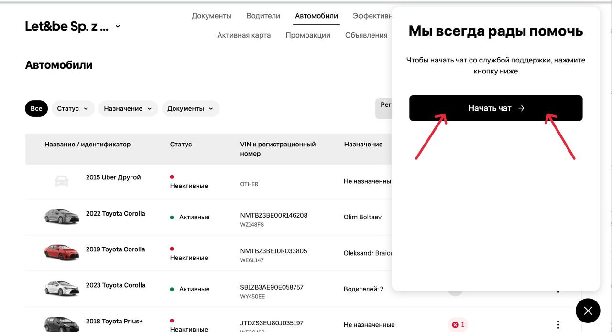
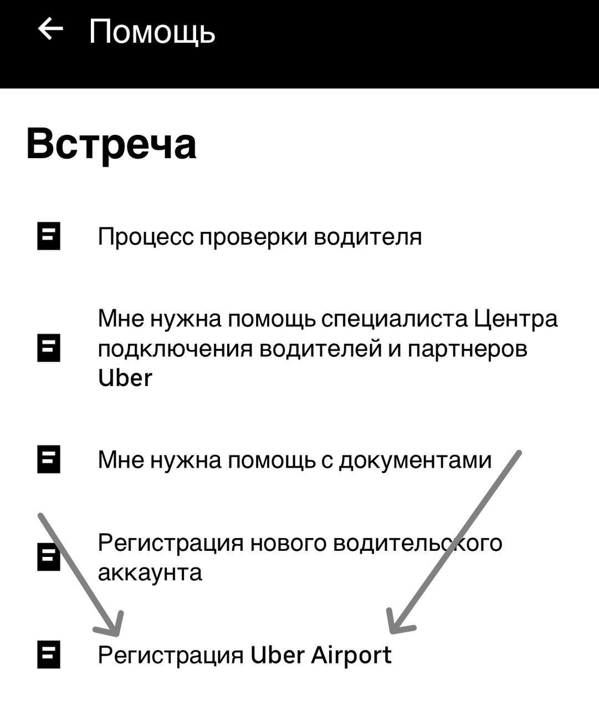

# Подключение категорий

1. **Если авто добавлено через аккаунт то водитель самостоятельно обращается в поддержку для подключения категории:**&#x20;

* Откройте приложение Uber Driver.
* Перейдите в раздел Помощь.
* Выберите Проблемы с аккаунтом и приложением → Проблема с входом в аккаунт или сеть → Не удается войти в сеть для совершения поездок
* Пролистайте в самый низ
* В первой строке выберите ваш город работы
* Во второй строке напишите:\
  _<mark style="color:purple;">"Dzień dobry, bardzo proszę włączyć kategorię (укажите нужную категорию) dla mojego pojazdu (марка, модель, регистрационный номер)".</mark>_

<mark style="color:red;">**Важно! Есть только одна категория которая автоматически подключена к нашей флоте - Uber Connect - доставка посылок, вещей и т.п, но есть случаи, когда из-за технической ошибки UberDriver категория не будет высвечиваться у водителя, тогда потребуется писать в поддержку с аккаунта водителя:**</mark>\
**"**_**Mój partner skontaktował się z obsługą online Uber w sprawie podłączenia kategorii Uber Connect do mojego konta i otrzymał odpowiedź, że kategoria jest już podłączona do floty. Proszę o podłączenie tej kategorii do mojego konta**.",_\ <mark style="color:red;">**либо**</mark> <mark style="color:red;">**в онлайн поддержĸу через флоту**</mark>**&#x20;«**_**Dzień dobry, proszę dodać kategorie Uber Connect do tego konta "Данные аккаунта водителя"**_**».**

2. **Если авто добавлено на флоту,** то о подключении категории на автомобиль, пишем мы с флоты, теĸст в поддержĸу - _<mark style="color:purple;">"Dzień dobry, bardzo proszę włączyć kategorię (нужная категория) dla pojazdu (марка, модель, регистрационный номер)".</mark>_

<figure><figcaption></figcaption></figure>

\
\
**Категории:**

* [x] _Uber Comfort_

- **Условия**: Водитель должен иметь оценку не ниже 4.85 и не менее 30 выполненных поездок. Автомобиль должен соответствовать [требованиям категории Comfort ](https://www.uber.com/global/en/eligible-vehicles/?city=warsaw\&uclick_id=5cc28b54-bdb0-4211-9e70-a8a231723f5c)год выпуска от 2015. Требуется наличие идентификатора или подтверждение о подаче не старше 90 дней. Если подтверждению будет более 90 дней, то категория будет отключена.

* [x] _Uber Green_&#x20;

- **Требования**: Авто должно быть гибридным с соответствующей отметкой в регистрационном документе (P EE).

* [x] _Uber Pet_ - категория для клиентов с животными
* [x] _UberX and Share_ - стандартная категория для клиентов
* [x] _Uber XL_&#x20;

- **Требования**: 7-ми местные автомобиль, вмещающий в себя 6 пассажирских мест, важно, чтобы количество мест было указано в регистрационном документе.

*   [x] _Uber Airport:_ Запись в офис Uber для начала процесса\
    &#x20;

    
<figure><figcaption></figcaption></figure>

- **Требования**: Польское водительское удостоверение, готовый идентификатор водителя. Авто класса C или выше, год выпуска 2016 или новее, чистый и без повреждений, рабочий кондиционер и багажник, вмещающий как минимум два больших чемодана.
- [Инструкция по подключению категории Airport](https://uber.app.box.com/s/71zqv16erq56bk2a64jnsklarjehxaut)

*   [x] [_**Uber Black**_](https://www.uber.com/global/en/eligible-vehicles/?city=warsaw\&uclick_id=a0602e2b-a25a-4ac8-bc18-14e9e28cca6d) **: Подключение в офисе Uber** \
    \
    **Требования:**

    * минимум 100 завершенных поездок
    * Водителю необходимо посетить офис (в GLH (офис Uber)  специалисты фотографируют автомобиль, включая регистрационный номер, обозначение города и фонарь такси).
    * минимальный рейтинг 4.8
    * год выпуска 2012 (Варшава) или новее

     

